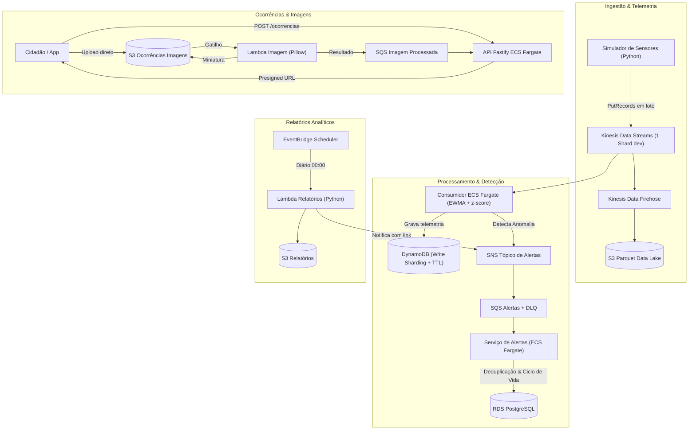

# SmartCity Pulse 🏙️⚡

Plataforma resiliente de monitoramento urbano e IoT em tempo real, construída segundo os princípios do **AWS Well-Architected Framework**. Implementa ingestão contínua de telemetria, detecção estatística de anomalias, tratamento de incidentes com upload de imagens e relatórios analíticos automatizados.

---

## 🏗️ Arquitetura Geral



---

## 📁 Estrutura do Repositório

```text
SmartCityPulse/
├── apps/
│   ├── api/                    # API Fastify com TypeScript, Swagger/OpenAPI
│   ├── telemetria-consumer/    # Consumidor Kinesis, DynamoDB e Detector EWMA
│   ├── alertas-service/        # Consumidor SQS, RDS PostgreSQL e Notificações
│   ├── simulator/              # Gerador sintético de telemetria em Python
│   └── lambdas/
│       ├── imagem-processor/   # Lambda em Python para miniaturas (Pillow)
│       └── relatorios/         # Lambda em Python agendada para relatórios diários
├── packages/
│   └── shared/                 # Schemas Zod, tipos TypeScript e DetectorEwma
├── docker/
│   ├── postgres/init.sql       # Schema inicial completo do PostgreSQL
│   └── localstack/init-aws.sh  # Script de provisionamento local (Kinesis, Dynamo, S3, SQS, SNS)
├── infra/
│   ├── envs/dev/               # Terraform dev (orçamento enxuto, NAT único, tags obrigatórias)
│   └── modules/                # Módulos: network, kinesis, dynamodb, s3, rds, sqs_sns
├── docs/
│   ├── adrs/                   # ADRs 001 a 005 (Fargate, Kinesis, DynamoDB Sharding, OTel, etc.)
│   ├── architecture/           # Documentação técnica e diagramas
│   └── runbooks/               # Procedimentos operacionais para alarmes
├── scripts/                    # Scripts utilitários de inicialização e teste
├── docker-compose.yml          # Emulação local completa (LocalStack + PostgreSQL)
└── package.json                # Monorepo npm workspaces
```

---

## 🚀 Como Executar Localmente

### 1. Pré-requisitos
- Docker & Docker Compose
- Node.js 20+ ou 24 LTS
- Python 3.11+ (para simulação ou execução local de lambdas)

### 2. Subir a Infraestrutura Local (Postgres + LocalStack)
```bash
# Iniciar LocalStack (Kinesis, DynamoDB, S3, SQS, SNS) e PostgreSQL
npm run compose:up

# Ou diretamente pelo script PowerShell:
powershell -ExecutionPolicy Bypass -File ./scripts/init-local-infra.ps1
```

O script automaticamente aguardará a inicialização e provisionará:
- **Stream Kinesis**: `smartcity-telemetria`
- **Tabelas DynamoDB**: `telemetria` (com GSI1 e TTL), `estado_sensor`, `idempotencia`
- **Buckets S3**: `smartcity-telemetria-raw`, `smartcity-ocorrencias-imagens`, `smartcity-relatorios`
- **Filas SQS & DLQs**: `smartcity-alertas-queue`, `smartcity-ocorrencias-imagem-queue`
- **Tópico SNS**: `smartcity-alertas-topic`
- **Tabelas PostgreSQL**: `zonas`, `sensores`, `regras_alerta`, `alertas`, `notificacoes`, `ocorrencias`, `usuarios`

### 3. Rodar o Simulador com Docker
```bash
npm run compose:apps
```

### 4. Parar o Ambiente
```bash
npm run compose:down
```

---

## 🛡️ Decisões de Arquitetura Registradas (ADRs)
- [ADR 001: ECS com Fargate vs EKS vs EC2](docs/adrs/001-fargate-vs-eks-vs-ec2.md)
- [ADR 002: Ingestão com Kinesis Data Streams vs SQS vs MSK](docs/adrs/002-kinesis-vs-sqs-vs-msk.md)
- [ADR 003: Modelagem DynamoDB, Write Sharding e TTL](docs/adrs/003-dynamodb-modelagem-sharding.md)
- [ADR 004: Terraform e Organização Modular](docs/adrs/004-terraform-vs-cdk.md)
- [ADR 005: OpenTelemetry com ADOT vs SDK Legado do X-Ray](docs/adrs/005-opentelemetry-adot-vs-xray-sdk.md)

